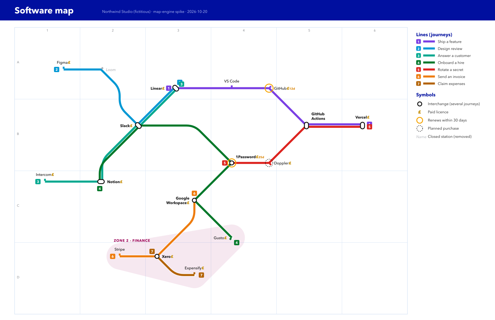

# softwaremetro

See the software you use as a metro map.

softwaremetro is a small, local-first tool for people and small companies who want to know what software they run, which licences they pay for and when those renew. You describe your software in YAML files kept in Git. softwaremetro turns them into a static website:

- **A metro map.** Each line is a journey, such as "ship a feature" or "send an invoice", and each station is a piece of software. Interchanges are the tools several journeys depend on.
- **A software list.** Each item has its own page with its licence, owner, renewal date, the journeys it serves and a diagram of what it depends on and what depends on it.
- **Reports.** Renewals, cost per month and year, items nobody owns, and drift between what a machine has installed and what the catalogue declares.

*Spike output with fictitious data. The tool itself is not built yet.*

## Status

Early design. Nothing is released. The scope is in [docs/roadmap.md](docs/roadmap.md), and each piece of work is an [OpenSpec](https://github.com/Fission-AI/OpenSpec) change under `openspec/changes/`.

## How it is meant to work

1. Keep your catalogue in its own Git repository, private if it holds real data, or in a local folder. It uses the [Backstage](https://backstage.io/docs/features/software-catalog/descriptor-format) `catalog-info.yaml` format, so a company that already runs Backstage can point softwaremetro at the same files.
2. Run `softwaremetro build` in that repository's pipeline. It produces a static site you can host anywhere. Put it behind a login when it holds real data.
3. On each Mac, `softwaremetro discover` records what is installed. `softwaremetro drift` shows what differs from the catalogue.

softwaremetro never stores secrets, needs no server or database, sends no telemetry and only reads the machines it inspects.

## Licence

[Apache-2.0](LICENSE)
