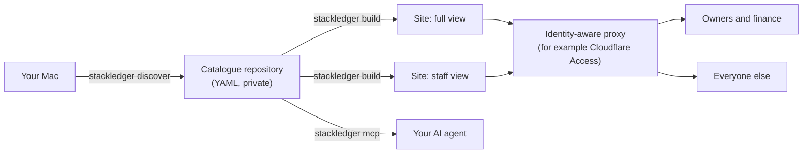

# stackledger

Govern your software stack and licences, drawn as a metro map.

stackledger is a small, local-first tool for people and small companies who want to know what software they run, who owns it, which licences they pay for and when those renew. You describe your software in YAML files kept in Git, in the [Backstage](https://backstage.io/docs/features/software-catalog/descriptor-format) format. stackledger checks them and turns them into a static website you host behind your own sign-in.

*Output of the map-engine spike, with a fictitious company. The tool is not released yet.*

## Contents

- [Status](#status)
- [Features](#features)
- [How it works](#how-it-works)
- [Security](#security)
- [Using it with AI agents](#using-it-with-ai-agents)
- [Usage](#usage)
- [How this project is built](#how-this-project-is-built)
- [Contributing](#contributing)
- [License](#license)

## Status

Early development. Nothing is released yet. The first piece of work, the catalogue format and the `validate` command, is in [pull request #1](https://github.com/brunosouzas/stackledger/pull/1). The order of the rest is in the [roadmap](docs/roadmap.md).

## Features

Planned for the first version:

- **A metro map of your software.** Each line is a journey, such as "ship a feature" or "send an invoice", and each station is a piece of software. Interchanges are the tools several journeys depend on. Stations stay where you put them, so the map does not reshuffle when the catalogue changes.
- **A software list with one page per item.** Owner, lifecycle, licence, the journeys it serves, a diagram of what it depends on and what depends on it, and what breaks if you remove it.
- **Licence reports.** Renewals, cost per month and year, and items nobody owns, with a calendar feed of renewal dates.
- **Drift on a Mac.** What is installed but not declared, and what is declared but missing.
- **Two views.** A `full` view for owners and finance, and a `staff` view without costs or renewal dates.
- **An MCP server**, so your AI agent can query and check the catalogue.

## How it works

1. **The catalogue lives in its own repository**, private when it holds real data. stackledger never holds your data. A company that already uses Backstage can point it at the same files. Why: [ADR 2](docs/adr/0002-catalogue-in-backstage-format-in-its-own-repository.md).
2. **Lines are journeys, not categories.** A journey has an order; a category does not. Categories become zones. Why: [ADR 3](docs/adr/0003-lines-are-journeys.md).
3. **The map engine is our own, and station positions are data.** Existing engines reshuffled the whole map after a small change. Why: [ADR 4](docs/adr/0004-own-map-engine-with-stored-positions.md).
4. **The website is static.** No server, no database, nothing to patch. Why: [ADR 5](docs/adr/0005-static-site-no-server.md).
5. **It is written in TypeScript**, so the same map engine runs at build time and in the browser. Why: [ADR 9](docs/adr/0009-typescript-end-to-end.md).

## Security

A software catalogue maps its owner's attack surface: which VPN, which secret store, which versions. stackledger is designed around that:

- **No sign-in code in the tool.** The site sits behind an identity-aware proxy that uses your existing accounts (Google Workspace, Microsoft 365). [ADR 6](docs/adr/0006-authentication-at-an-identity-aware-proxy.md)
- **Two views, built as two sites.** The `staff` site does not contain costs, renewal dates, payers, seats or password-manager references at all, so nothing leaks through the browser. You choose the hidden fields. [ADR 7](docs/adr/0007-two-views-built-as-separate-sites.md)
- **No secrets in the catalogue.** `validate` rejects fields named like secrets, private keys and card numbers, and never repeats the value in its message.
- **Nothing leaves your machine.** No telemetry, no analytics, no third-party scripts; discovery only reads and never uses `sudo`.
- **Read access to the catalogue repository equals the `full` view.** Give everyone else the website.

To report a vulnerability, see [SECURITY.md](SECURITY.md).

## Using it with AI agents

stackledger does not call any AI model. Instead, a read-only [MCP](https://modelcontextprotocol.io/) server lets the agent you already use (Claude, Codex or any MCP client) ask questions such as "what depends on this app?", "what breaks if I remove it?" or "what renews this month?", and validate the YAML it writes. With `--view staff` it serves only what the staff view shows. Why: [ADR 8](docs/adr/0008-read-only-mcp-early-no-ai-in-the-core.md).

## Usage

Not available yet. The planned commands are:

| Command | Does | Change |
|---|---|---|
| `stackledger validate [folder]` | Checks a catalogue and reports each problem with file, line and field | `catalogue-model` |
| `stackledger mcp` | Serves the catalogue to AI agents over MCP | `mcp-server` |
| `stackledger build` | Builds the `full` and `staff` sites | `catalogue-site` |
| `stackledger discover`, `stackledger drift` | Records what a Mac has installed, and compares it with the catalogue | `mac-discovery` |

## How this project is built

stackledger follows spec-driven development:

- **What it does:** each piece of work is an [OpenSpec](https://github.com/Fission-AI/OpenSpec) change in [`openspec/changes/`](openspec/changes/), with a proposal, specs with testable scenarios, a design and tasks. Delivered specs are in [`openspec/specs/`](openspec/specs/).
- **Why it is shaped this way:** project-wide decisions are [architecture decision records](docs/adr/README.md). [ADR 1](docs/adr/0001-record-architecture-decisions.md) explains how they relate to the OpenSpec changes.
- **What comes next:** the [roadmap](docs/roadmap.md).
- **Experiments:** [`docs/spikes/`](docs/spikes/).

## Contributing

Issues and pull requests are welcome. For a change in behaviour, open an issue first so we can agree on the scenario before the code. Use only fictitious data in issues, examples and tests: never paste a real catalogue. Agents working in this repository start from [AGENTS.md](AGENTS.md).

## License

[Apache-2.0](LICENSE) © 2026 Bruno Souza
