# stackledger

Govern your software stack and licences, drawn as a metro map.

[](https://github.com/brunosouzas/stackledger/actions/workflows/openspec.yml)
[](LICENSE)

stackledger is a small, local-first tool for people and small companies who want to know what software they run, who owns it, which licences they pay for and when those renew. You describe your software in YAML files kept in Git, in the [Backstage](https://backstage.io/docs/features/software-catalog/descriptor-format) format. stackledger checks them and turns them into a static website you host behind your own sign-in. On a Mac it can also record what is installed and compare it with the catalogue, without changing either: you or your agent then update the catalogue through a reviewed pull request.

<picture>
  <source media="(prefers-color-scheme: dark)" srcset="docs/images/map-dark.svg">
  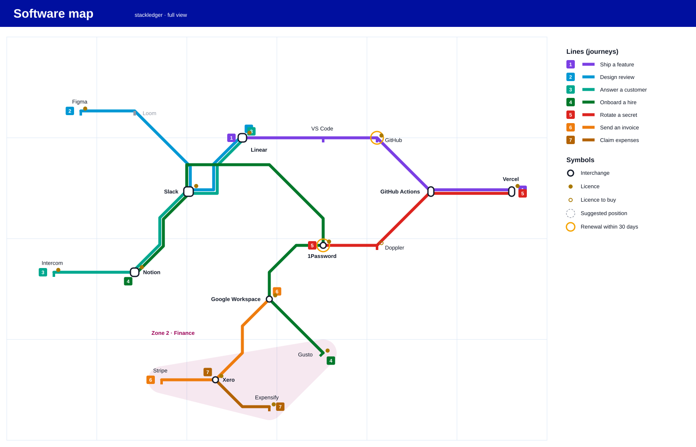
</picture>

*Generated by `stackledger map` from the fictitious [Northwind catalogue](examples/northwind/), dated 2027-06-01. The tool is not released yet.*

## Contents

- [Status](#status)
- [Features](#features)
- [How it works](#how-it-works)
- [Security](#security)
- [Using it with AI agents](#using-it-with-ai-agents)
- [Usage](#usage)
- [The website](#the-website)
- [Catalogue format](#catalogue-format)
- [How this project is built](#how-this-project-is-built)
- [Contributing](#contributing)
- [License](#license)

## Status

Early development. Nothing is released to npm yet. The catalogue format, the `validate`, `map`, `build` and `report` commands, the `mcp` server and Mac discovery (`stackledger discover` and `stackledger drift`) work from source (see [Usage](#usage)). The order of the rest is in the [roadmap](docs/roadmap.md).

For a separate catalogue repository, copy the [pipeline template](examples/catalogue-repository/). Set up [protected hosting](docs/hosting.md) before the first deploy. The fictitious Northwind catalogue runs as a demo of the corporate mode at <https://stackledger-demo.pages.dev/>; it is protected by Cloudflare Access and only the owner can sign in, so for you it shows the sign-in page, which is the point. The [release guide](docs/release.md) covers npm publication, provenance and the SBOM.

## Features

Planned for the first version:

- **A metro map of your software.** Each line is a journey, such as "ship a feature" or "send an invoice", and each station is a piece of software. Interchanges are the tools several journeys depend on. Stations stay where you put them, so the map does not reshuffle when the catalogue changes.
- **A software list with one page per item.** Owner, lifecycle, licence, the journeys it serves, a diagram of what it depends on and what depends on it, and what breaks if you remove it.
- **Licence reports.** Renewals, cost per month and year for each currency by owner, payer and zone, and items nobody owns, with a calendar file of renewal dates.
- **Drift on a Mac.** What is installed but not declared, and what is declared but missing.
- **Two views.** A `full` view for owners and finance, and a `staff` view without costs or renewal dates.
- **An MCP server**, so your AI agent can query and check the catalogue.

## How it works

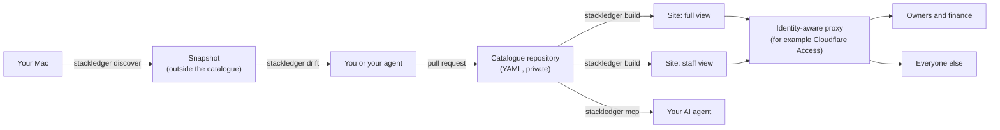

1. **The catalogue lives in its own repository**, private when it holds real data. stackledger never holds your data. A company that already uses Backstage can point it at the same files. Why: [ADR 2](docs/adr/0002-catalogue-in-backstage-format-in-its-own-repository.md).
2. **Lines are journeys, not categories.** A journey has an order; a category does not. Categories become zones. Why: [ADR 3](docs/adr/0003-lines-are-journeys.md).
3. **The map engine is our own, and station positions are data.** Existing engines reshuffled the whole map after a small change. Why: [ADR 4](docs/adr/0004-own-map-engine-with-stored-positions.md).
4. **The website is static.** No server, no database, nothing to patch. Why: [ADR 5](docs/adr/0005-static-site-no-server.md).
5. **It is written in TypeScript**, so the same map engine runs at build time and in the browser. Why: [ADR 9](docs/adr/0009-typescript-end-to-end.md).

[How it works, end to end](docs/how-it-works.md) draws the publication path: a push to `main` of the private catalogue repository, GitHub Actions, Cloudflare Pages behind Cloudflare Access, and the personal (one site, one reader) and corporate (two sites) modes.

## Security

A software catalogue maps its owner's attack surface: which VPN, which secret store, which versions. stackledger is designed around that:

- **No sign-in code in the tool.** The site sits behind an identity-aware proxy that uses your existing accounts (Google Workspace, Microsoft 365). [ADR 6](docs/adr/0006-authentication-at-an-identity-aware-proxy.md)
- **Two views, built as two sites.** The `staff` site does not contain costs, renewal dates, payers, seats, password-manager references or notes at all, so nothing leaks through the browser. You choose the hidden fields. [ADR 7](docs/adr/0007-two-views-built-as-separate-sites.md)
- **No secrets in the catalogue.** `validate` rejects fields named like secrets, private keys and card numbers, and never repeats the value in its message.
- **Nothing leaves your machine.** No telemetry, no analytics, no third-party scripts; discovery only reads and never uses `sudo`.
- **Read access to the catalogue repository equals the `full` view.** Give everyone else the website.

To report a vulnerability, see [SECURITY.md](SECURITY.md).

## Using it with AI agents

stackledger does not call any AI model. Instead, a read-only [MCP](https://modelcontextprotocol.io/) server lets the agent you already use (Claude Code, Codex, Hermes or any MCP client) ask questions such as "what depends on this app?", "what breaks if I remove it?" or "what renews this month?", and validate the YAML it writes. With `--view staff` it serves only what the staff view shows, and offers no renewals or validation. Why: [ADR 8](docs/adr/0008-read-only-mcp-early-no-ai-in-the-core.md).

- [docs/mcp.md](docs/mcp.md): the tools, the views, and configuration for Claude Code, Codex and Hermes.
- [skills/stackledger/SKILL.md](skills/stackledger/SKILL.md): an agent skill for maintaining a catalogue (add an item, link a licence, add a line, place a station, run `validate`).

## Usage

The package is not published to npm yet. Once 0.1.0 is released, use npm with Node.js 22.12 or later:

```sh
npx stackledger@0.1.0 --help
npx stackledger@0.1.0 validate /path/to/catalogue
```

Until then, run it from source:

```sh
npm ci
npm run build
node dist/cli.js validate /path/to/catalogue
node dist/cli.js validate /path/to/catalogue --json
node dist/cli.js mcp /path/to/catalogue --view staff
node dist/cli.js map examples/northwind --date 2027-06-01 > map.svg
node dist/cli.js build examples/northwind --out ./public --date 2027-06-01
node dist/cli.js report examples/northwind --date 2027-06-01 --format csv > licences.csv
node dist/cli.js discover
node dist/cli.js drift examples/northwind --snapshot examples/northwind-machine/snapshot.json
```

| Command | Does | Status |
|---|---|---|
| `stackledger validate [folder]` | Checks a catalogue and reports each problem with file, line and field. Exit 0: no errors (warnings allowed); 1: catalogue errors; 2: usage or folder problem | Available from source |
| `stackledger mcp <folder> [--view full\|staff]` | Serves the catalogue read-only to AI agents over MCP on stdio; see [docs/mcp.md](docs/mcp.md). Exit 2: usage or folder problem | Available from source |
| `stackledger map <folder> [--view full\|staff] [--theme light\|dark] [--date YYYY-MM-DD]` | Draws a self-contained SVG on stdout; diagnostics and suggestions on stderr. Exit 0 even with catalogue errors; 2 for usage/folder problems. See [docs/map.md](docs/map.md) | Available from source |
| `stackledger build <folder> --out <dir> [--date YYYY-MM-DD]` | Builds the `full` and `staff` static sites into `<dir>/full/` and `<dir>/staff/` (only `full` in the personal mode), with `_headers`, `robots.txt` and `_redirects`, replacing an earlier build atomically; report on stderr. Exit 0 even with catalogue errors; 1: internal failure (the earlier build is left as it was); 2: usage or folder problem. See [docs/site.md](docs/site.md) | Available from source |
| `stackledger report <folder> [--date YYYY-MM-DD] [--days N] [--format text\|json\|csv\|ics]` | Prints the licence report of the `full` view on stdout: renewals in the next `--days` (default 90), recurring cost per currency by owner, payer and zone, one-off and planned costs, incomplete licences; or the renewal calendar. Exit 0 even with catalogue errors; 1: the report could not be computed or written; 2: usage or folder problem. See [docs/reports.md](docs/reports.md) | Available from source |
| `stackledger discover` | Reads what this Mac has installed (Homebrew, App Store, applications, launchd, mise, npm, pipx), with every program in the macOS sandbox, and writes `~/.stackledger/<machine>/snapshot.json`; one summary line per source on stdout. Exit 0 also with skipped sources; 1: not macOS, no sandbox or the file could not be written safely; 2: usage problem. See [docs/discovery.md](docs/discovery.md) | Available from source |
| `stackledger drift <folder> [--snapshot <file>] [--format text\|json] [--scaffold <dir>]` | Compares the snapshot with the catalogue through `stackledger/<source>` annotations: what is not declared (with the annotation to add), what is missing, what could not be checked, and `dependsOn` relations to confirm; `--scaffold` writes draft component files into a new folder outside the catalogue. Exit 0 even with catalogue errors; 1: internal or write failure; 2: usage, folder or snapshot problem. See [docs/discovery.md](docs/discovery.md) | Available from source |

`validate`, `mcp`, `map`, `report` and `drift` only read files (`drift --scaffold` writes only inside the new folder it names); `build` writes only inside its output folder; `discover` writes only its snapshot file. None of them makes network calls or sends telemetry, and none edits the catalogue. The text output and error messages of `validate`, `report`, `discover` and `drift` carry no control characters from file names, options, catalogue or snapshot text, and their JSON output writes U+007F to U+009F as `\u` escapes; `build` and `mcp` keep their own rules, described in their documents.

## The website

`stackledger build` makes two static sites from one catalogue: `full` for owners and finance, `staff` for everyone else, without costs, renewal dates, payers, seats, password-manager references or notes. Serve them behind an identity-aware proxy, publishing only `full/`, `staff/`, `_headers`, `robots.txt` and `_redirects`; with `spec.sites: [full]` (the personal mode) only `full` is built; [docs/site.md](docs/site.md) explains the pages, the hosting and the security rules. Screenshots from the fictitious [Northwind catalogue](examples/northwind/), dated 2027-06-01:

| | |
|---|---|
| 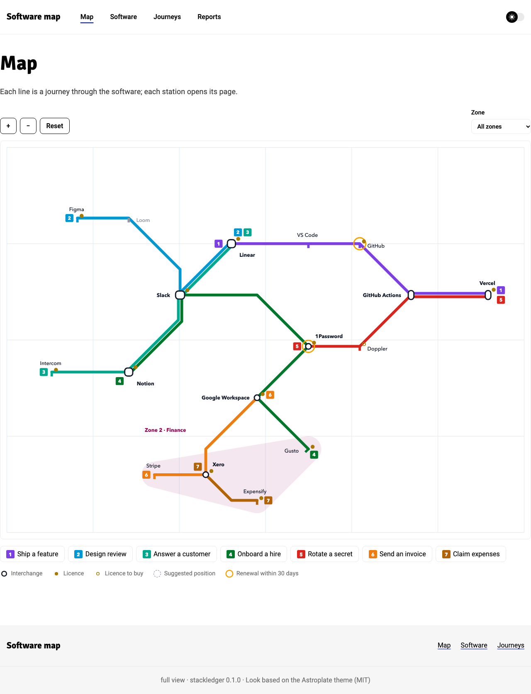 | 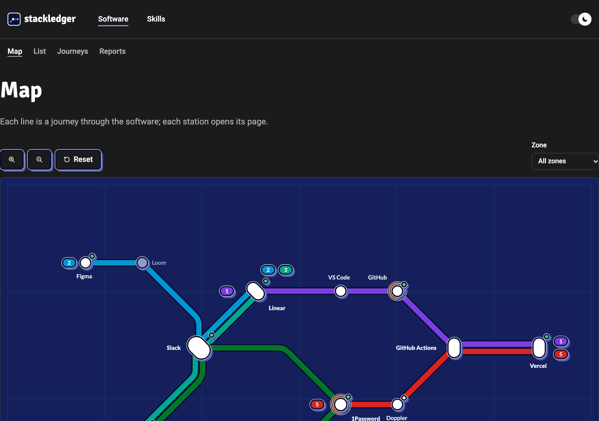 |
| **Map**: zoom, pan, zone filter; the line buttons highlight a journey | **Dark theme**, remembered across pages |
| 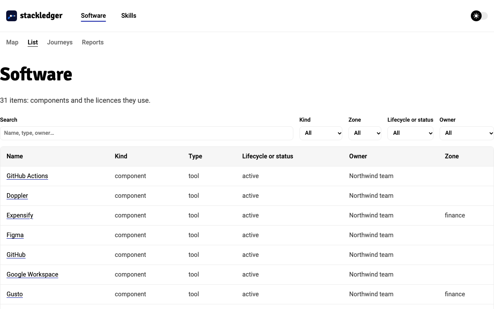 | 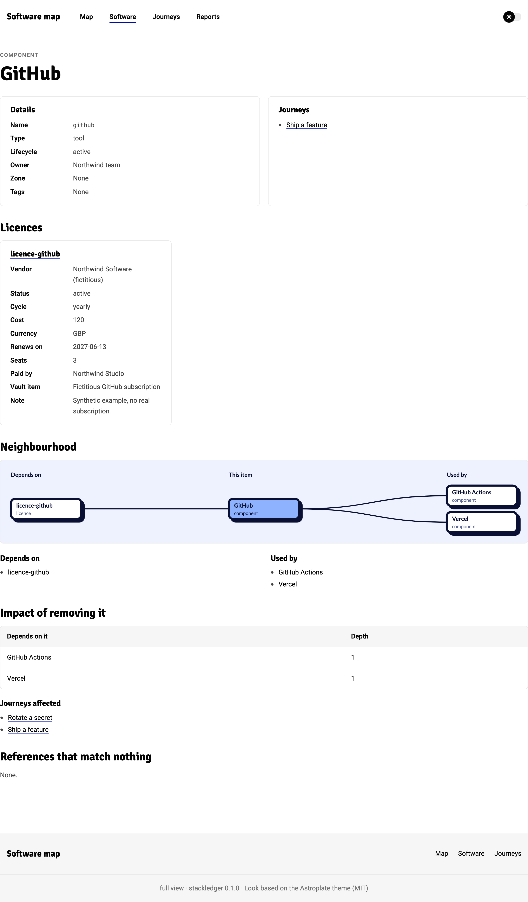 |
| **Software**: every component and licence, with search and filters | **Component**: licence, journeys, what it depends on and what depends on it, removal impact |
| 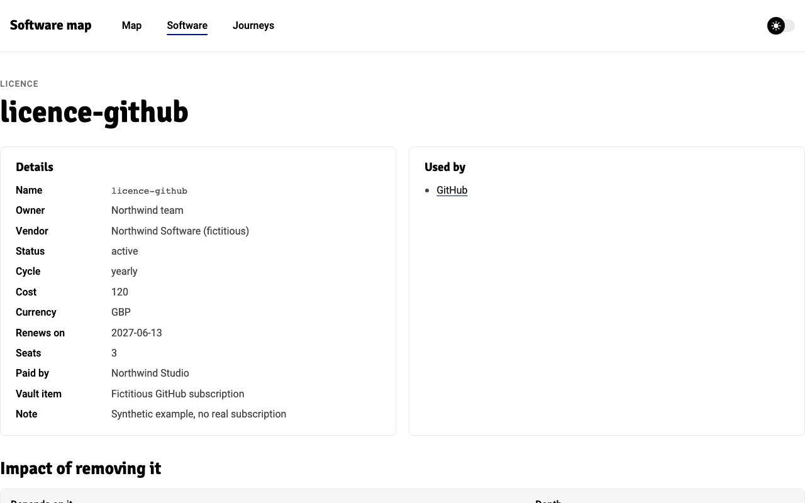 | 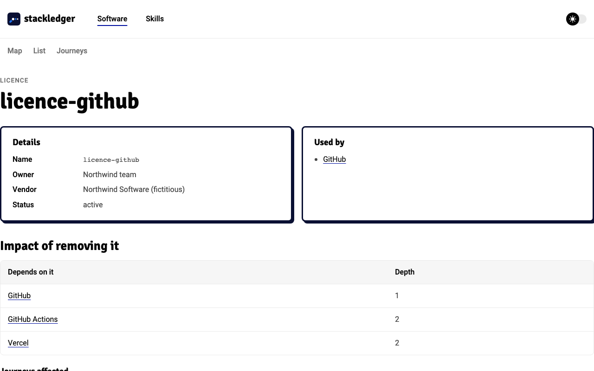 |
| **Licence, `full` site** | **The same licence, `staff` site**: the hidden fields are not in the files at all |
| 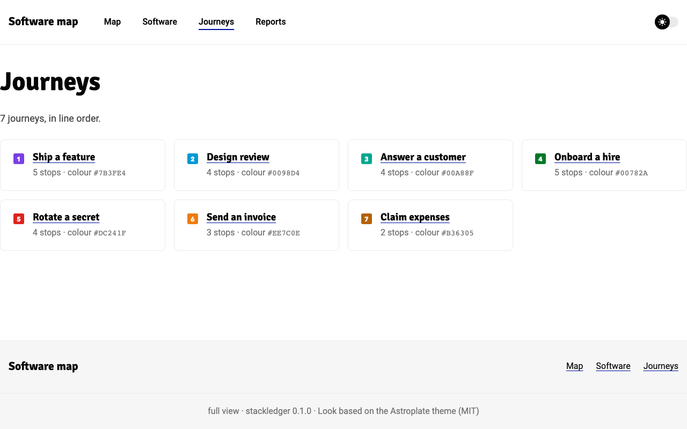 | 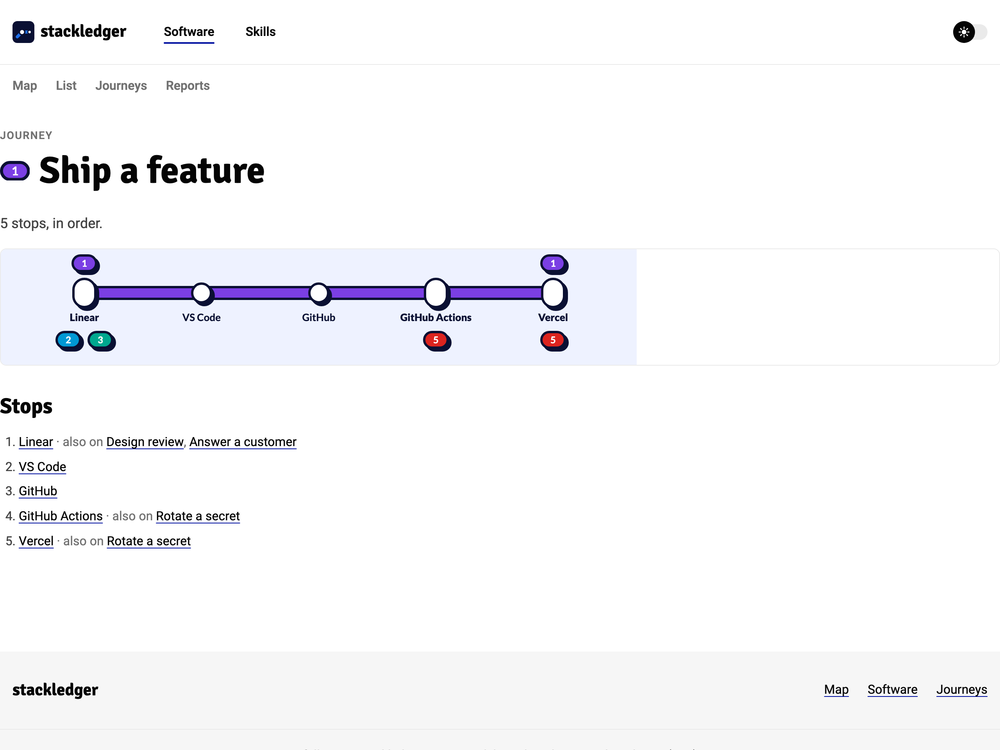 |
| **Journeys** | **Journey**: stops in order, with the other lines at each interchange |
| 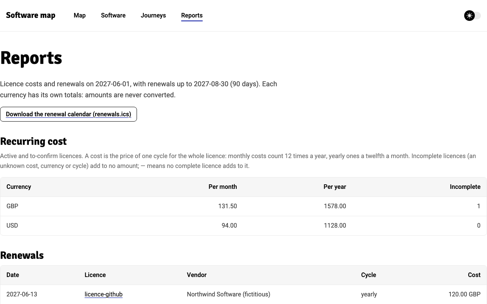 | |
| **Reports**, `full` site only: renewals, cost per month and year per currency and group, and the calendar file | |

## Catalogue format

A catalogue is a folder of YAML files: Backstage `Component` documents for software, `Resource` documents with `spec.type: licence` for licences, plus `Line` journeys, one `MapLayout` with station positions and zones, and an optional `Settings` document that chooses the fields the staff view hides. The [format reference](docs/catalogue-format.md) describes every field, how references work, which problems are warnings, and how to share the folder with a Backstage instance. Keep real data in its own private repository; this example is fictitious. Save it as `catalogue.yaml` in an empty folder and run `validate` on that folder:

```yaml
apiVersion: backstage.io/v1alpha1
kind: Component
metadata:
  name: editor
spec:
  type: tool
  lifecycle: active
  owner: user:alex
  dependsOn: [resource:licence-editor]
---
apiVersion: backstage.io/v1alpha1
kind: Component
metadata:
  name: forge
spec:
  type: service
  lifecycle: active
  owner: group:delivery
---
apiVersion: backstage.io/v1alpha1
kind: Resource
metadata:
  name: licence-editor
spec:
  type: licence
  owner: user:alex
  licence:
    vendor: Northwind Studio
    status: active
    cycle: yearly
    cost: 120
    currency: GBP
    renewsOn: 2027-06-30
    vaultItem: Northwind Editor subscription
---
apiVersion: stackledger/v1alpha1
kind: Line
metadata:
  name: ship
spec:
  color: '#4466FF'
  stops: [component:editor, component:forge]
---
apiVersion: stackledger/v1alpha1
kind: MapLayout
metadata:
  name: northwind
spec:
  stations:
    component:editor: [0, 0]
    component:forge: [2, 0]
```

## How this project is built

stackledger follows spec-driven development:

- **What it does:** each piece of work is an [OpenSpec](https://github.com/Fission-AI/OpenSpec) change in [`openspec/changes/`](openspec/changes/), with a proposal, specs with testable scenarios, a design and tasks. Delivered specs are in [`openspec/specs/`](openspec/specs/).
- **Why it is shaped this way:** project-wide decisions are [architecture decision records](docs/adr/README.md). [ADR 1](docs/adr/0001-record-architecture-decisions.md) explains how they relate to the OpenSpec changes.
- **What comes next:** the [roadmap](docs/roadmap.md).
- **Experiments:** [`docs/spikes/`](docs/spikes/).

## Contributing

Issues and pull requests are welcome. For a change in behaviour, open an issue first so we can agree on the scenario before the code. Use only fictitious data in issues, examples and tests: never paste a real catalogue. Agents working in this repository start from [AGENTS.md](AGENTS.md).

## License

[Apache-2.0](LICENSE) © 2026 Bruno Souza
