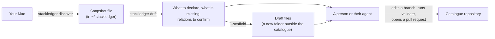

# Mac discovery and drift

stackledger can read what is installed on a Mac and compare it with the catalogue, so the person who keeps the catalogue sees what to add, what to remove and which relations to confirm. Two commands do it:

- `stackledger discover` reads this Mac, without changing it, and writes one snapshot file outside any catalogue.
- `stackledger drift <folder>` compares that snapshot with the catalogue and prints the differences. With `--scaffold <dir>` it also writes draft catalogue files for what is not declared yet.

Neither command edits the catalogue. Matching goes only through the `stackledger/<source>` annotations on components ([catalogue format](catalogue-format.md#Discovery%20annotations)), never through names, so drift never guesses.

## From a Mac to a reviewed pull request



1. Run `stackledger discover` on the Mac. It writes `~/.stackledger/<machine>/snapshot.json`.
2. Run `stackledger drift /path/to/catalogue`. It reads that snapshot and prints, per item, the annotation it would need.
3. Optionally add `--scaffold ./new-items` to get one draft `Component` file per item that is not declared.
4. A person, or the agent they use ([skills/stackledger/SKILL.md](../skills/stackledger/SKILL.md)), works in a branch of the catalogue repository: adds the annotations drift printed to existing components, moves the reviewed drafts in after setting their real owner, confirms or rejects each proposed relation, runs `stackledger validate`, and opens a pull request. Someone reviews and merges it.

stackledger never writes in the catalogue folder and never opens a pull request: every change to the catalogue goes through a person's review.

Try it on the fictitious example, which needs no Mac:

```sh
npm ci
npm run build
node dist/cli.js drift examples/northwind --snapshot examples/northwind-machine/snapshot.json
```

## stackledger discover

`stackledger discover` takes no folder and no option. It runs only on macOS: on another system, or when `/usr/bin/sandbox-exec` does not exist, it exits 1 with one line before anything runs.

It prints the snapshot path, then one line per source with its status, item count, ignored count and reason:

```
/Users/username/.stackledger/username-macbook-air/snapshot.json
brew     ok       items 5     ignored 0
cask     ok       items 6     ignored 0
mas      skipped  items 0     ignored 0  not found
app      ok       items 8     ignored 0
launchd  ok       items 3     ignored 1
mise     ok       items 1     ignored 0
npm      ok       items 2     ignored 0
pipx     ok       items 1     ignored 0
```

| Exit | When |
| --- | --- |
| 0 | The snapshot is written, also when sources are skipped or failed. |
| 1 | Not macOS, no sandbox, a secret in a `machine` field, an unsafe or unwritable snapshot folder, a snapshot larger than 32 MiB, a snapshot that fails the checks `drift` reads it with, or a failed write: stderr has one line and any earlier snapshot is left as it was. |
| 2 | Any argument or option (`--help` aside): stderr has the reason and usage; nothing runs. |

### Sources

Sources are read in this order. A source whose program or folders are absent is `skipped`; one that cannot be read is `failed` with no items. Neither stops the others.

| Source | What runs or is read | Item |
| --- | --- | --- |
| `brew` and `cask` | One run of `brew info --json=v2 --installed` | Formula: full name (`northwind/tools/ledger` for a tap), installed versions, `onRequest`, runtime dependencies declared directly. Cask: full token, version, the `.app` bundles it installs |
| `mas` | `mas list` | App Store identifier, name, version |
| `app` | The `*.app` folders directly in `/Applications` and `~/Applications` and one folder level below; for each, `plutil -convert json -o - <app>/Contents/Info.plist`, or when that fails `plutil -extract <key> raw -expect string -o - <file>` for `CFBundleIdentifier`, `CFBundleDisplayName`, `CFBundleName` and `CFBundleShortVersionString`; whether `Contents/_MASReceipt` exists | Bundle identifier, title (display name, else bundle name, else folder name, else the identifier), version, path, `appStore` |
| `launchd` | The `.plist` files in `~/Library/LaunchAgents`, `/Library/LaunchAgents` and `/Library/LaunchDaemons`; for each, `plutil -extract Label raw -expect string -o - <file>`, then `Program`, else `ProgramArguments.0` the same way; for an interpreter job, `ProgramArguments.1` too, then `test -f <script>` | Label, scope (`user-agent`, `agent`, `daemon`), path, program, script |
| `mise` | The folders in `installs` of the mise data folder (`$MISE_DATA_DIR`, else `$XDG_DATA_HOME/mise`, else `~/.local/share/mise`); `mise` itself is never run | Tool name and its version folders (links such as `latest` left out) |
| `npm` | `npm ls --global --depth=0 --json --offline`, with the `npm` found on `PATH` | Package name and version |
| `pipx` | `venvs/*/pipx_metadata.json` in the pipx home (`$PIPX_HOME`, else `~/.local/pipx` when it exists, else `~/Library/Application Support/pipx`); `pipx` itself is never run, because it writes a log on every run | Package name and version |

The machine name and version come from `scutil --get ComputerName`, `scutil --get LocalHostName` and `sw_vers -productVersion`. A program is looked up in the absolute folders of `PATH` in order, then in `/opt/homebrew/bin` and `/usr/local/bin`. Relative and empty `PATH` entries (such as `bin` or `::`) are skipped: they would make the folder you happen to run discovery from decide which `brew` or `npm` runs.

Only three keys of a launchd file are read, so a job's arguments and environment variables (which may hold tokens) never reach the snapshot. The one exception is a job whose program is an interpreter: `sh`, `bash`, `zsh`, `dash`, `ksh`, `python`, `python3`, `python3.<digits>`, `node`, `ruby`, `perl` or `osascript`, compared exactly with the name after the program's last `/`. Its program says nothing about what it runs, so `ProgramArguments.1` is read too and kept as `script` only when it is an absolute path that `test -f`, run in the sandbox like every program, finds to be a file. A flag (`bash -c`, `python3 -m`), inline code or a token, even one starting with `/`, gives `script` `null`, and no later argument is read. Jobs started through `/usr/bin/env` keep `script` `null`. Symbolic links are never followed: a linked app or plist, a linked folder a source reads (`/Applications`, `~/Applications`, a subfolder of either, a launchd folder, the mise data folder, its `installs` or a tool folder in it, the pipx home, its `venvs` or a venv), and an app whose `Contents` or `Info.plist` is a link each count as one ignored entry, so `drift` marks a missing identifier of that source `incomplete`. An `.app` entry that cannot be examined, any other entry of an Applications folder that cannot be examined (it may be a subfolder) and a subfolder that cannot be listed are counted as ignored too, since each may hide an app. A listed `.plist`, mise tool folder or pipx venv that cannot be examined is counted as ignored for the same reason: it may be a job, a tool or a package. Folders are listed by Node itself; only `plutil` runs per file, eight at a time.

A skipped or failed source records one fixed reason: `not found`, `exited with code <n>`, `time limit`, `output limit`, `unreadable output` or `cannot be read`. No program output reaches the snapshot, the summary or the terminal.

### The sandbox, and what fails closed

Every program discovery starts, `scutil` included, runs as `/usr/bin/sandbox-exec -p <profile> <program> <args…>`, without a shell, with this profile:

```
(version 1)
(allow default)
(deny network*)
(deny file-write* (require-not (literal "/dev/null")))
```

So read-only is enforced by macOS, not only intended: the [spike](spikes/2026-10-21-mac-discovery/README.md) showed that a plain `npm` run writes a log and can delete older ones. A program gets only `PATH`, `HOME`, `USER` and `TMPDIR` from your environment, plus `HOMEBREW_NO_AUTO_UPDATE=1`, `HOMEBREW_NO_ANALYTICS=1`, `HOMEBREW_NO_ENV_HINTS=1`, `HOMEBREW_NO_INSTALL_CLEANUP=1`, `npm_config_update_notifier=false`, `NO_COLOR=1` and `LC_ALL=C`. Each run is stopped after 60 seconds or once its output passes 64 MiB.

- Without `/usr/bin/sandbox-exec`, discovery refuses to start: nothing runs, nothing is read, nothing is written. Apple has marked `sandbox-exec` deprecated for years but still ships it; if it ever goes, discovery stops instead of silently losing the guarantee.
- Homebrew reads its cached API files inside the sandbox. With no cache and no network it fails, and `brew` and `cask` are `failed` with `exited with code <n>`: run any `brew` command once while online.
- No `sudo`, no network, no telemetry, no AI model.

### The snapshot file

The only write is the snapshot, at `~/.stackledger/<machine>/snapshot.json`:

- `~/.stackledger` and the machine folder are created with mode `0700` when missing; existing ones are never changed. The run refuses (exit 1, nothing written) a home folder that group or others can write, a snapshot folder that is a link, not a folder, not yours or open to group or others, and a `snapshot.json` that is not a regular file.
- The file is written with mode `0600` to a new temporary file in the machine folder, then renamed over `snapshot.json`, so a reader sees either the previous complete file or the new one. Two runs at once each rename a complete file; the last one wins. Each run replaces the file: there is no history.
- The folders are checked again after the temporary file is created and before the rename, and before the rename the temporary path must still lead to the file written (same device and inode). This detects a folder or file swapped by your own processes; it is not a boundary against them. Other users cannot write anything on the path.
- After a failure the temporary file is removed only while its path still leads to the file written. When even its identity could not be read, it is left in the machine folder and the error line says so; delete it by hand once you have checked it.

**Machine name.** `ComputerName` folded to one path segment: Unicode NFKD, accents removed, lower case, each run of characters other than `a`–`z` and `0`–`9` replaced by one `-`, `-` trimmed from both ends, cut to 63 characters. `username - MacBook Air` becomes `username-macbook-air`; `MacBook de João` becomes `macbook-de-joao`. When that is empty, `LocalHostName` is folded the same way; when that is empty too, the name is `mac`.

The snapshot keeps your macOS user name and the paths as found, which is why it lives outside every catalogue repository and is private to you. Do not commit it. An item that holds private-key material or a payment-card number (the catalogue's [secret guard](catalogue-format.md#Secret%20and%20personal-data%20guard)) is left out and counted as ignored; such a value in a `machine` field stops the run. E-mail addresses are not checked.

The format is `stackledger-snapshot/v1` ([full example](../examples/northwind-machine/snapshot.json)):

```json
{
  "format": "stackledger-snapshot/v1",
  "takenAt": "2026-10-21T07:30:00Z",
  "machine": { "name": "username-macbook-air", "user": "username", "macos": "27.2" },
  "sources": [
    { "source": "brew", "status": "ok", "reason": null, "items": 2, "ignored": 0 },
    { "source": "mas", "status": "skipped", "reason": "not found", "items": 0, "ignored": 0 }
  ],
  "items": [
    { "source": "brew", "id": "forge", "versions": ["2.1.0"], "onRequest": true, "dependsOn": ["libnorth"] },
    { "source": "cask", "id": "northwind-editor", "versions": ["5.0.1"], "apps": ["Northwind Editor.app"] },
    { "source": "mas", "id": "1234567890", "versions": ["4.2"], "title": "Northwind Notes" },
    { "source": "app", "id": "com.northwind.editor", "versions": ["5.0.1"], "title": "Northwind Editor", "path": "/Applications/Northwind Editor.app", "appStore": false },
    { "source": "launchd", "id": "com.northwind.sync", "versions": [], "scope": "user-agent", "path": "/Users/username/Library/LaunchAgents/com.northwind.sync.plist", "program": "/Applications/Northwind Sync.app/Contents/MacOS/sync", "script": null },
    { "source": "mise", "id": "node", "versions": ["22.12.0", "24.1.0"] },
    { "source": "npm", "id": "northwind-cli", "versions": ["3.0.0"] },
    { "source": "pipx", "id": "northwind-docs", "versions": ["1.6.0"] }
  ]
}
```

- `sources` always has the eight sources, in source order; two are shown. `takenAt` is UTC to the second. `machine.macos` is `null` when it cannot be read.
- Each source has exactly the fields shown for it; an unknown field makes the file invalid. `versions` is always empty for `launchd`, empty for an app without `CFBundleShortVersionString`, and never empty for the other sources; `program` and `script` may be `null`. A snapshot written before `script` existed has no `script` on its launchd items and is read as if each were `null`; `drift` 0.6.0 and older reject a snapshot that has it (exit 2, shape not valid), so run `discover` and `drift` from the same version.
- Consistency: every item's source is `ok`; each source's `items` equals its number of items; `reason` is `null` exactly when the status is `ok`; no two items share source, `id` and `path`.
- Items without a path and with the same `id` in one source are merged (lists united). Items are sorted by source order, then `id`, then `path`, by Unicode code point; every list is sorted without repeats. Characters U+007F to U+009F are written as `\u` escapes. The same machine gives the same bytes apart from `takenAt`.

## stackledger drift

```sh
node dist/cli.js drift /path/to/catalogue
node dist/cli.js drift /path/to/catalogue --format json > drift.json
node dist/cli.js drift /path/to/catalogue --snapshot /path/to/snapshot.json
node dist/cli.js drift /path/to/catalogue --scaffold ./new-items
```

`stackledger drift <folder> [--snapshot <file>] [--format text|json] [--scaffold <dir>]` compares the snapshot with the components the catalogue's `full` view serves. Without `--snapshot` it reads this Mac's `~/.stackledger/<machine>/snapshot.json`, which needs the machine name and so macOS and the sandbox; elsewhere, pass `--snapshot`. Without `--scaffold` it only reads the catalogue folder and the snapshot.

| Exit | When |
| --- | --- |
| 0 | The result is printed, whether or not anything differs. A catalogue with errors is still compared, using what the `full` view serves; stderr then has the counts line that `stackledger report` writes. |
| 1 | The result could not be computed, written to stdout (for example piped into `head`), or the scaffold files could not be written: stderr has one line. |
| 2 | A usage, folder or snapshot problem: `--help` aside, a missing folder, more than one folder, an unknown option or format, a folder that is missing, not a folder or unreadable; no snapshot (stderr says to run `stackledger discover`); a snapshot that is not a regular file, is over 32 MiB, is not JSON, has another format or shape, is not consistent or breaks the secret guard; no machine name without `--snapshot`; a `--scaffold` folder that exists, is inside the catalogue or contains it, or whose parent, or a folder above it, other users can write or another user owns. stdout is empty and the reason never repeats the snapshot's path or content. |

### What it compares

- **Matching.** A component matches an item when its `stackledger/<source>` annotation lists the item's `id`. Identifiers compare exactly, except `app` (ASCII case ignored) and `pipx` (lower case, each run of `-`, `_` and `.` read as one `-`). A name or title never matches: a component named `git` without annotations does not match the formula `git`.
- **Not declared.** Each item no component matches, with the annotation it would need, such as `stackledger/cask: northwind-editor`.
- **Counted, not listed.** Formulae installed only as dependencies (`onRequest` false), apps whose identifier starts with `com.apple.` and have no App Store receipt, and launchd labels starting with `com.apple.`. They still match when annotated. Without this rule most Homebrew lines would be dependencies.
- **Cannot be annotated.** An `id` that holds a comma or a control character, or starts or ends with white space, never matches; it is listed with the note `cannot be annotated` and no annotation (unless the rule above counts it).
- **Missing.** An identifier a component lists for a source that is `ok` that matches no item. It is marked `incomplete` when that source ignored entries: the identifier may be in one it could not read.
- **Not checked.** An identifier for a source that was `skipped` or `failed`: never reported as missing.
- **Shared.** An item that two or more components match. It counts once as matched; `stackledger validate` warns about the second component.
- **Inferred needs.** A formula needs the formulae in its `dependsOn`. A launchd job needs the app whose path, plus `/`, starts its program (`Northwind Sync Helper.app` never matches `Northwind Sync.app`), and the formula whose `Cellar` or `opt` folder under `/opt/homebrew` or `/usr/local` holds its program, matched by the part of the formula's name after its last `/`, unless two formulae have that short name.
- **Proposed relations.** When component A matches an item that needs an item component B matches, A and B differ, and A's `spec.dependsOn` does not already reference B (ignoring case), drift proposes `A dependsOn B` with the pairs of items that suggest it.
- **Apps a cask installs.** When components match a cask whose `apps` holds the folder name of an app nobody matches, that app's entry suggests those components: they probably need its `stackledger/app` annotation too.

Versions are not compared. One snapshot is compared at a time; nothing records which Mac a component should be on.

### Text output

The machine and `takenAt`, the counts, then not declared (by source), missing, not checked, shared and proposed relations, one line per entry. Empty sections are left out; with nothing to report, the last line says there is no drift. Control characters from the catalogue or the snapshot are removed. The Northwind example prints:

```
Drift of username-macbook-air (user username, macOS 27.2), snapshot taken 2026-10-21T07:30:00Z
Counts: items 27, matched 14, not declared 10, dependencies 1, macOS items 2, missing 2, not checked 1, shared 0, proposed relations 1, components without annotations 6

Not declared
brew  forge 2.1.0  -> stackledger/brew: forge
cask  northwind-editor 5.0.1  -> stackledger/cask: northwind-editor
app  com.northwind.draw 3.2  Northwind Draw (/Users/username/Applications/Northwind Draw.app)  -> stackledger/app: com.northwind.draw
app  com.northwind.editor 5.0.1  Northwind Editor (/Applications/Northwind Editor.app)  -> stackledger/app: com.northwind.editor
app  com.tinyspeck.slackmacgap 4.46.101  Slack (/Applications/Slack.app)  -> stackledger/app: com.tinyspeck.slackmacgap  (probably belongs to component:slack)
launchd  com.northwind.indexer (/Users/username/Library/LaunchAgents/com.northwind.indexer.plist)  runs /usr/bin/python3 /Users/username/northwind/indexer.py  -> stackledger/launchd: com.northwind.indexer
launchd  com.northwind.sync,helper (/Library/LaunchAgents/com.northwind.sync.helper.plist)  runs /Applications/Northwind Editor.app/Contents/MacOS/sync-helper  cannot be annotated
mise  node 22.12.0, 24.1.0  -> stackledger/mise: node
npm  northwind-cli 3.0.0  -> stackledger/npm: northwind-cli
pipx  northwind-docs 1.6.0  -> stackledger/pipx: northwind-docs

Missing
missing  component:loom  cask loom
missing  component:loom  launchd com.northwind.loom-uploader (incomplete source)

Not checked
not checked  component:expensify  mas 1234567890 (skipped)

Proposed relations
propose  component:onepass dependsOn component:doppler  (launchd com.northwind.secrets-sync (/Users/username/Library/LaunchAgents/com.northwind.secrets-sync.plist) needs brew dopplerhq/cli/doppler)
```

A shared item prints as `shared  cask northwind-editor  component:editor, component:editor-beta`.

### JSON output

With `--format json`, one object, stable within version 1:

```json
{
  "snapshot": { "machine": { "name": "username-macbook-air", "user": "username", "macos": "27.2" }, "takenAt": "2026-10-21T07:30:00Z" },
  "counts": { "items": 40, "matched": 30, "notDeclared": 4, "dependencies": 5, "macos": 1, "missing": 2, "notChecked": 1, "shared": 1, "proposedRelations": 2, "componentsWithoutAnnotations": 3 },
  "notDeclared": [{ "source": "cask", "id": "northwind-editor", "path": null, "program": null, "script": null, "versions": ["5.0.1"], "title": null, "annotation": "stackledger/cask: northwind-editor", "note": null, "suggestedComponents": [] }],
  "missing": [{ "component": "component:legacy", "source": "app", "id": "com.northwind.legacy", "incomplete": false }],
  "notChecked": [{ "component": "component:notes", "source": "mas", "id": "1234567890", "status": "skipped" }],
  "shared": [{ "source": "cask", "id": "northwind-editor", "path": null, "components": ["component:editor", "component:editor-beta"] }],
  "matched": [{ "source": "brew", "id": "forge", "path": null, "components": ["component:forge"] }],
  "proposedRelations": [{ "from": "component:forge", "to": "component:libnorth", "reasons": [{ "from": { "source": "brew", "id": "forge", "path": null }, "to": { "source": "brew", "id": "libnorth", "path": null } }] }]
}
```

- An item is named by `source`, `id` and `path` (`null` for sources without one). `program` and `script` say what a launchd job runs (each may be `null`) and are `null` for other sources; the text output prints them as `runs <program> [<script>]` after the path. `title` is the item's title or `null`. `annotation` is `null`, and `note` is `cannot be annotated`, for an identifier no annotation can hold; otherwise `note` is `null`. `suggestedComponents` may be empty.
- `counts.items` is every snapshot item; `matched` counts items matched at least once (shared ones once); `dependencies` and `macos` count the items left out of `notDeclared`; `componentsWithoutAnnotations` counts served components with no discovery annotation.
- `missing` and `notChecked` hold the identifier as the component wrote it. Components are `component:<name>` as the catalogue writes the name. Shared items are also in `matched`.
- Characters U+007F to U+009F are written as `\u` escapes; values parse back unchanged.

**Order.** Items by source order, then `id`, then `path` (no path first); entries that name a component by that component first; components by reference; relations by their two references. References compare by name in Unicode code points (`component:Zed` before `component:alpha`), as the tool's other results do. The same snapshot and catalogue always give the same bytes.

### Draft files: --scaffold

`--scaffold <dir>` also writes one draft `Component` file per item listed as not declared, so you review and move files instead of writing each by hand. stdout is the same as without the option.

- `dir` must not exist yet, and must be neither inside the catalogue folder nor contain it (their real paths are compared, so a link does not get around it). The folder that holds it, and every folder above that one up to `/` (along its real path), must belong to you or root and must not be writable by group or others, unless it has the sticky bit as `/tmp` has: otherwise another user could swap `dir`, or a folder on the way to it, for a link, and the command exits 2. stackledger creates `dir` with mode `0700` and an exclusive create: if it appears in the meantime, the command exits 2 and writes nothing in it. If the folder it made is not where it checked (a folder on the way was replaced by a link meanwhile, for example into the catalogue), it removes that folder while it is still empty and the one it made, and exits 1 without writing a file. Each file is created new with mode `0644`; before each one, and before stdout, `dir` must still be the folder it created and not a link, or the command stops with exit 1. Nothing is written beside `dir`, and never in the catalogue.
- Everything is built and checked before the first write. If a write fails, the files this run created and `dir` are removed, stdout stays empty, and the command exits 1. A file counts as created by this run only while it is still the same file (device and inode): a file another process put in `dir`, or put in place of a draft, is kept, and so is `dir` then. `dir` itself is removed only while it is still the folder made, checked right before the removal.
- Grouping: items with the same source and identifier (as matching compares them) share one file, so an app in `/Applications` and in `~/Applications` gives one file. An app that a listed cask installs goes into the file of the first such cask. Items with suggested components, without annotation, or only counted get no file.
- Name: the title, else the part of the `id` after its last `/`, folded as the machine name is (`item` when nothing is left). A name already used by a catalogue `Component` (even one with errors) or an earlier file, ignoring case, gets `-2`, `-3` and so on, within 63 characters. The file is `<name>.yaml`.
- Content: `metadata.name`, `metadata.title` (the title without control characters, else the `id`), the discovery annotations in source order, `spec.type` (`service` for a launchd job, else `tool`), `lifecycle: active`, `owner: unknown`, and `spec.dependsOn` with the catalogue components and other drafts that match what the file's items need. No path, program, script, version or machine name is copied.
- Each file is checked as a one-file catalogue with the rules of `stackledger validate`, the secret guard and the 1 MiB limit included. A file with an error is left out, other drafts stop naming it, and stderr says how many were left out.

```yaml
# Draft written by stackledger drift --scaffold from a snapshot taken 2026-10-21T07:30:00Z.
# Review the owner, lifecycle, description and journeys, then move it into the catalogue.
apiVersion: backstage.io/v1alpha1
kind: Component
metadata:
  name: northwind-editor
  title: Northwind Editor
  annotations:
    stackledger/cask: northwind-editor
    stackledger/app: com.northwind.editor
spec:
  type: tool
  lifecycle: active
  owner: unknown
```

Before a draft goes into the catalogue, replace `owner: unknown` with the real owner, and add the description, the journeys it is on, its station and any licence: drafts never hold journeys, licences or prices.

## A weekly run with launchd

stackledger has no scheduler. To run it every Monday at 09:00, save a LaunchAgent such as this one (fictitious paths) as `~/Library/LaunchAgents/com.northwind.stackledger-discover.plist`. It runs `discover`, then `drift` against a local clone of the catalogue, and writes the result to a log file; it never edits the catalogue.

```xml
<?xml version="1.0" encoding="UTF-8"?>
<!DOCTYPE plist PUBLIC "-//Apple//DTD PLIST 1.0//EN" "http://www.apple.com/DTDs/PropertyList-1.0.dtd">
<plist version="1.0">
<dict>
  <key>Label</key>
  <string>com.northwind.stackledger-discover</string>
  <key>ProgramArguments</key>
  <array>
    <string>/bin/sh</string>
    <string>-c</string>
    <string>/opt/homebrew/bin/node /Users/username/stackledger/dist/cli.js discover &amp;&amp; /opt/homebrew/bin/node /Users/username/stackledger/dist/cli.js drift /Users/username/northwind-catalogue</string>
  </array>
  <key>EnvironmentVariables</key>
  <dict>
    <key>PATH</key>
    <string>/opt/homebrew/bin:/usr/local/bin:/usr/bin:/bin</string>
  </dict>
  <key>StartCalendarInterval</key>
  <dict>
    <key>Weekday</key>
    <integer>1</integer>
    <key>Hour</key>
    <integer>9</integer>
    <key>Minute</key>
    <integer>0</integer>
  </dict>
  <key>StandardOutPath</key>
  <string>/Users/username/Library/Logs/stackledger-drift.txt</string>
  <key>StandardErrorPath</key>
  <string>/Users/username/Library/Logs/stackledger-drift.txt</string>
</dict>
</plist>
```

```sh
launchctl bootstrap gui/$(id -u) ~/Library/LaunchAgents/com.northwind.stackledger-discover.plist
```

`PATH` lets discovery find `brew`, `mas` and `npm`, because launchd starts jobs with a minimal environment. The log holds the snapshot path, the source lines and the drift text; read it, or let your agent read `drift --format json`, and change the catalogue through a pull request. The job itself shows up in the next drift as the launchd item `com.northwind.stackledger-discover`: annotate the component that owns it.

## Limits

- Each program run: 60 seconds and 64 MiB of output. The snapshot `drift` reads: 32 MiB. Each draft file: 1 MiB.
- `drift` compares 2,000 items with 500 components in under 2 seconds (`npm run test:perf` checks it).
- macOS only, one machine per snapshot. No Windows or Linux collector, nothing inside `/System`.
- Only the global packages of the `npm` on `PATH`; pip packages only through pipx; App Store purchases only when installed.
- A launchd job's label and program, plus the script of an interpreter job: never its other arguments, environment, or whether it is loaded or running.
- `mas` and mise output formats come from their documentation and fixtures; they were not on the spike machine.
- No history: each `discover` run replaces the machine's snapshot. Discovery data is not shown in the site, the map, the report or the MCP server.
