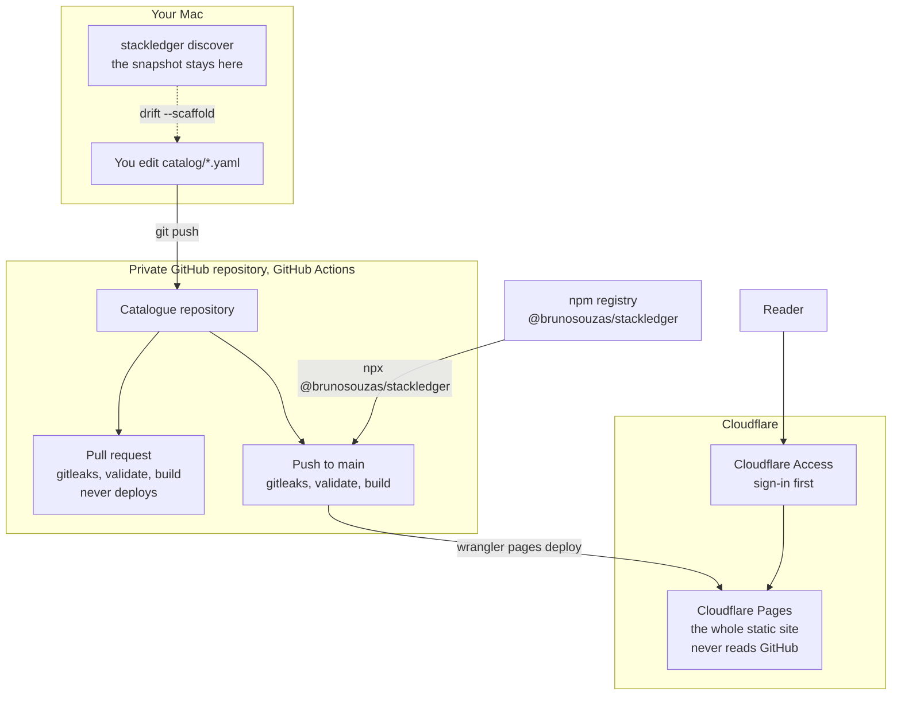

# How it works

stackledger turns a catalogue of your software and licences into a static website. This page shows where each piece runs when you publish it with the [catalogue repository template](../examples/catalogue-repository/).

![On your Mac, stackledger discover writes a snapshot that stays there, and drift --scaffold suggests entries as you edit catalog/*.yaml. A git push sends the catalogue to a private GitHub repository. A pull request runs gitleaks, validate and build but never deploys. A push to main runs gitleaks, validate and build with stackledger from the npm registry, then wrangler pages deploy sends the whole static site to Cloudflare Pages, which never reads GitHub. A reader reaches Pages only through Cloudflare Access, signing in first.](images/how-it-works.svg)

1. **The catalogue lives in a private Git repository.** It is a folder of YAML files ([catalogue format](catalogue-format.md)). Read access to the repository means reading everything, costs included, so keep it private.
2. **Your Mac only helps you write it.** `stackledger discover` lists what is installed and writes a snapshot that stays on the Mac; `stackledger drift --scaffold` suggests catalogue entries from it ([discovery](discovery.md)). Nothing from the Mac is published unless you commit it.
3. **A push to `main` publishes.** GitHub Actions scans the repository for secrets with gitleaks, runs `stackledger validate`, builds the site with stackledger from npm, and a separate job deploys the whole static site to Cloudflare Pages.
4. **Pull requests never deploy.** They run the same checks and build, so a broken catalogue is caught before it reaches `main`.
5. **Readers sign in first.** Cloudflare Access sits in front of every address of the Pages project ([hosting](hosting.md)). The site is static files only: it never reads GitHub, has no server code and makes no outside requests.

## Personal or corporate

| | Personal | Corporate (default) |
| --- | --- | --- |
| Who reads it | you alone | finance and the rest of the company |
| `spec.sites` in `stackledger.yaml` | `[full]` | not set, or `[full, staff]` |
| Sites | `full`, with costs | `full` for finance, `staff` without costs for everyone else |
| Cloudflare Access | one application, only you | two: finance on `/full/*`, staff on the rest |
| `/` leads to | `/full/` | `/staff/` |

The diagram is drawn by [`@brunosouzas/design-system`](https://www.npmjs.com/package/@brunosouzas/design-system) from the spec [`scripts/how-it-works.json`](../scripts/how-it-works.json), which follows the Mermaid block above: after changing either, run `npm run build && node scripts/site-art.mjs`.
