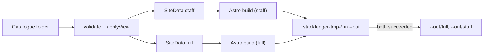

# Design: catalogue-site

## Context

Delivered: catalogue and `Settings`, the `full`/`staff` views (`src/views.ts`), graph queries (`src/graph.ts`, shared with MCP), the map engine (`src/map/`) and the commands `validate`, `mcp` and `map`. [ADR 5](../../../docs/adr/0005-static-site-no-server.md) chose a static site built with Astro; on 2026-10-20 the owner confirmed Astro for the shared look with brunosouzas.com, page patterns and editability, with guardrails. [ADR 6](../../../docs/adr/0006-authentication-at-an-identity-aware-proxy.md) and [ADR 7](../../../docs/adr/0007-two-views-built-as-separate-sites.md) set hosting and views.

The spec review found that plain Astro does not meet three of our rules out of the box: it writes `.astro/` into its project root, emits root-absolute asset URLs (`/_astro/...`), and inlines small CSS and scripts (which a single fixed CSP would block). The decisions below work around each; task 0 is a spike that proves them before the site is built.

## Goals / Non-goals

Goals: a pleasant, fast site; two sites that cannot leak into each other; output safe behind a proxy; brunosouzas.com's look.

Non-goals: reports, editing, sign-in, translations, server rendering.

## Decisions

### D1. Data first, then Astro

`src/site/data.ts` builds one plain JSON object per view (`SiteData`): items, lines, graph results, the map SVGs (light and dark) and the diagrams, already rendered by the map engine. The staff data is built from the staff view only, without the date, and its Astro build runs first, with its own data file and cache, before the full data exists on disk. Pages never import the catalogue code.

### D2. Astro run from a working copy

Astro writes `.astro/` into its root, so the shipped `site/` folder is copied into a folder under the system temporary directory for each build and used as `root`; `node_modules` is linked to the package's, so `astro` and the fonts resolve without writing in the package. `cacheDir` is inside that temporary folder, `outDir` inside `--out/.stackledger-tmp-*`, telemetry is disabled with `ASTRO_TELEMETRY_DISABLED=1`, and the spike checks that nothing is written under `$HOME`. Config: `output: 'static'`, `trailingSlash: 'always'`, `build.format: 'directory'`, `build.inlineStylesheets: 'never'`, `vite.build.assetsInlineLimit: 0`, no integrations, no `is:inline` and no `define:vars`.

### D3. Relative URLs by a post-build rewrite

Astro has no relative `base`. After each build, `src/site/relative.ts` rewrites every root-absolute URL in HTML attributes and CSS `url()` (only those pointing into the site, such as `/_astro/...` and page links) into a path relative to the file's depth, deterministically. It then fails the build if any root-absolute or external URL remains. This is safe because pages hold no inline code, so no hash changes.

### D4. One fixed CSP

With no inline code (D2), every page gets the same `meta` policy written by the layout; Astro's own CSP feature is not needed. `_headers` carries the same policy plus `frame-ancestors 'none'` and the other headers. Both `_headers` and `robots.txt` are written at the root of `--out` and inside each site.

### D5. Look

`site/src/styles/tokens.css` holds the brunosouzas.com colour tokens (light and dark), font families (Heebo and Signika from `@fontsource` packages, copied as local files) and the type scale. `layouts/Base.astro` follows the site's header and footer structure (Astroplate, MIT, credited in `site/LICENSE-astroplate`). `spec.site.colors` produce a generated `override.css` for the light theme, with validated colours only.

### D6. Diagrams and links

`src/map/neighbourhood.ts` (three columns) and `src/map/strip.ts` (a straight line of stops) reuse `escapeXml`, themes and allow-lists from `src/map/svg.ts`. Links are HTML: a text list next to each diagram; the page script also opens a page when a box with `data-ref` is clicked or focused and Enter is pressed (no positioned overlays, which would need inline styles).

### D7. Interactivity

One small TypeScript module per page in `site/src/scripts/`, bundled as files: pan and zoom change the SVG `viewBox`; line highlight and zone filter toggle classes on elements by `data-line` and `data-zone` (added to the map engine); stations get `tabindex` and `role="link"` from the script, not in the SVG. The software list filters its own table rows (no JSON data block, so nothing for `</script>` to break out of). The theme switch stores `light`/`dark` in `localStorage`.

### D8. Atomic replace

Both sites are built into `--out/.stackledger-tmp-*` (same filesystem as the target, so renames are atomic). On success: rename old `full/` and `staff/` aside, rename the new ones in, write `_headers`, `robots.txt` and the marker, remove the old ones. On failure: remove the temporary folders only.

### D9. Tests

Unit tests on `SiteData` and the diagrams; build tests on the files of both sites (leak strings, CSP equality, no inline code, relative and local URLs, robots, headers, hostile titles); a sandbox build under the permission model; a Playwright test (development dependency, CI only) that serves both sites under `/full/` and `/staff/` of one local server and checks CSP violations, failed requests and the interactions.

## Risks / Trade-offs

- **Dependency weight** (about 160 packages, 135 MB). Accepted by the owner; pinned versions, lockfile, `npm audit` in CI.
- **Working around Astro defaults** (D2, D3) may break on an Astro upgrade; the spike and the build tests catch it.
- **The look belongs to a personal site.** Companies change title and colours; a deeper theme is a later change.
- **Playwright** adds a browser download to CI only.
