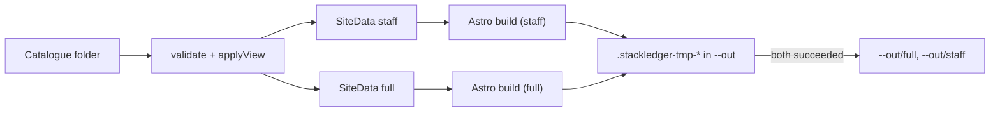

# Design: catalogue-site

## Context

Delivered: catalogue and `Settings`, the `full`/`staff` views (`src/views.ts`), graph queries (`src/graph.ts`, shared with MCP), the map engine (`src/map/`) and the commands `validate`, `mcp` and `map`. [ADR 5](../../../docs/adr/0005-static-site-no-server.md) chose a static site built with Astro; on 2026-10-20 the owner confirmed Astro for the shared look with brunosouzas.com, page patterns and editability, with guardrails. [ADR 6](../../../docs/adr/0006-authentication-at-an-identity-aware-proxy.md) and [ADR 7](../../../docs/adr/0007-two-views-built-as-separate-sites.md) set hosting and views.

The spec review found that plain Astro does not meet three of our rules out of the box: it writes `.astro/` into its project root, emits root-absolute asset URLs (`/_astro/...`), and inlines small CSS and scripts (which a single fixed CSP would block). The decisions below work around each; task 0 is a spike that proves them before the site is built.

## Goals / Non-goals

Goals: a pleasant, fast site; two sites that cannot leak into each other; output safe behind a proxy; brunosouzas.com's look.

Non-goals: reports, editing, sign-in, translations, server rendering.

## Decisions

### D1. Data first, then Astro

`src/site/data.ts` builds one plain JSON object per view (`SiteData`): items, lines, graph results, the map SVGs (light and dark) and the diagrams, already rendered by the map engine. The staff data is built from the staff view only, without the date, and its Astro build runs first, with its own data file and cache, before the full data exists on disk. Pages never import the catalogue code.

### D2. Astro run from a working copy

Astro writes `.astro/` into its root, so the shipped `site/` folder is copied (and made writable) into the staging folder `--out/.stackledger-tmp-*/work-<view>/` for each build and used as `root`. Astro runs with that working copy as its current directory, and `outDir` is `work-<view>/dist`, renamed to `site-<view>/` afterwards: with `outDir` outside the current directory, Astro writes `<cwd>/.astro/.prerender/`. Packages (`astro`, fonts) resolve from the installed stackledger package through a small Vite resolver plugin; a `node_modules` symbolic link is not used, because the Node.js permission model refuses `fs.symlink` without full read and write access. `vite.ssr.noExternal: true` and `vite.environments.prerender.resolve.noExternal: true` bundle every dependency into the render step, so a package of the same name elsewhere in the tree (for example `cookie` from the MCP SDK) is never picked up. Both Astro `cacheDir` and `vite.cacheDir` point into the staging folder, and `logLevel` is `error` so Astro's output does not mix with the build report. The spike (`docs/spikes/2026-10-20-astro-build/`) proved this configuration. Nothing goes to the system temporary directory. Telemetry is disabled with `ASTRO_TELEMETRY_DISABLED=1`; the spike checks that nothing is written under `$HOME` or in the package.

Versions: Astro 7 needs Vite 8 and Node >= 22.12. The current `overrides: { vite: 6.4.4 }` in `package.json` is removed (Vitest 4.1 accepts Vite 8), `engines.node` becomes `>=22.12`, and Astro is pinned to 7.3.8, the last 7.x whose `engines` allows 22.12 (7.4 requires 22.22); `esbuild` is pinned as a development dependency because Vite 8 no longer installs it. CI keeps Node 22, 24 and 26. This narrows ADR 9's "Node >= 22" without changing its decision. Config: `output: 'static'`, `trailingSlash: 'always'`, `build.format: 'directory'`, `build.inlineStylesheets: 'never'`, `vite.build.assetsInlineLimit: 0`, no integrations, no `is:inline` and no `define:vars`.

### D3. Relative URLs by a post-build rewrite

Astro has no relative `base`. Page links are written relative by the layout's `href()` helper. For assets, `src/site/relative.ts` rewrites after each build, deterministically:

- HTML URL attributes: `/_astro/...` becomes relative to the page's folder depth;
- CSS `url()` and `@import`: relative to the stylesheet (fonts sit next to it in `_astro/`);
- JavaScript: the bundle is kept to one entry module per page with no dynamic imports and no `import.meta.url` assets (`build.rollupOptions.output.inlineDynamicImports` per entry, no `?url` imports); static imports between chunks in `_astro/` are already relative (`./x.js`), and Vite's module preload helper is disabled (`build.modulePreload: false`).

Then a scan of every HTML, CSS and JavaScript file fails the build if any root-absolute, protocol-relative or external URL, any dynamic `import(` or any `import.meta.url` remains. This is safe because pages hold no inline code, so no hash changes. The spike checks this on nested pages with a shared chunk and a font.

### D4. One fixed CSP

With no inline code (D2), every page gets the same `meta` policy written by the layout; Astro's own CSP feature is not needed. `_headers` carries the same policy plus `frame-ancestors 'none'` and the other headers. Both `_headers` and `robots.txt` are written at the root of `--out` and inside each site.

### D5. Look

`site/src/styles/tokens.css` holds the brunosouzas.com colour tokens (light and dark), font families (Heebo and Signika from `@fontsource` packages, copied as local files) and the type scale. `layouts/Base.astro` follows the site's header and footer structure (Astroplate, MIT, credited in `site/LICENSE-astroplate`). `spec.site.colors` produce a generated `override.css` for the light theme, with validated colours only.

### D6. Diagrams and links

`src/map/neighbourhood.ts` (three columns) and `src/map/strip.ts` (a straight line of stops) reuse `escapeXml`, themes and allow-lists from `src/map/svg.ts`. Links are HTML: a text list next to each diagram; the page script also opens a page when a box with `data-ref` is clicked or focused and Enter is pressed (no positioned overlays, which would need inline styles).

### D7. Interactivity

One small TypeScript module per page in `site/src/scripts/`, bundled as files: pan and zoom change the SVG `viewBox`; line highlight and zone filter toggle classes on elements by `data-line` and `data-zone` (added to the map engine); stations get `tabindex` and `role="link"` from the script, not in the SVG. The software list filters its own table rows (no JSON data block, so nothing for `</script>` to break out of). The theme switch stores `light`/`dark` in `localStorage`.

### D8. Atomic replace

Everything is prepared in `--out/.stackledger-tmp-<random>/` (same filesystem, so renames are atomic): `site-staff/`, `site-full/` and `root/` with `_headers`, `robots.txt` and the marker. Publication, in order, for each entry `staff`, `full`, `_headers`, `robots.txt`, `.stackledger-build`: rename the existing entry to `stage/old/<entry>`, then rename the new one into place, recording each step in a journal file in the staging folder (`src/site/journal.ts`). The rename of the marker is the commit point. A failure before it undoes the recorded steps in reverse (new entry back to staging, old entry back into place), removes the staging folder and exits 1; if the undo itself fails, the staging folder is kept. After the commit the staging folder, with the old entries, is removed; a failure there is a warning. A crashed process or a failed undo can leave a staging folder: the next build first finishes any unfinished journal, then removes stale `.stackledger-tmp-*` folders, or exits 1 deleting nothing. Every entry is checked with `lstat` before a rename or removal, and the output folder's real path and (dev, ino) are checked again before each destructive step (`src/site/paths.ts`); Node has no directory handles with no-follow semantics, so the build trusts that no other process renames the output folder or its parents meanwhile (documented in `docs/site.md`). The journal is not fsynced, because the Node permission model disables fsync; it covers failures and crashes, not power loss. Tests inject a failure at every step, an undo failure followed by a new build, and a folder swap at each check point. The fault hooks are passed to the command's core function by a test-only entry script; the shipped CLI reads no test variable.

`docs/site.md` tells the reader to publish only `full/`, `staff/`, `_headers` and `robots.txt` (for example `wrangler pages deploy` of a copy, or a CI step that builds into a clean folder) and never to serve `--out` while a build runs.

### D9. Tests

Unit tests on `SiteData` and the diagrams; build tests on the files of both sites (leak strings, CSP equality, no inline code, relative and local URLs, robots, headers, hostile titles); a sandbox build under the permission model; a Playwright test (development dependency, CI only) that serves both sites under `/full/` and `/staff/` of one local server and checks CSP violations, failed requests and the interactions.

## Risks / Trade-offs

- **Dependency weight** (281 packages, 159 MB installed, measured in the spike). Accepted by the owner; pinned versions, lockfile, `npm audit` in CI.
- **Working around Astro defaults** (D2, D3) may break on an Astro upgrade; the spike and the build tests catch it.
- **The look belongs to a personal site.** Companies change title and colours; a deeper theme is a later change.
- **Playwright** adds a browser download to CI only.
- **Node 22.12 floor and a pinned older Astro 7.x** to keep Node 22 support; moving to a later 7.x means `engines.node >= 22.22`.
- **Staging inside `--out`** holds full-view files while a build runs; mitigated by the rule not to serve `--out` during a build and to publish only the four entries.
