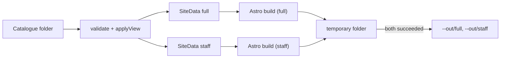

# Design: catalogue-site

## Context

Delivered: catalogue and `Settings`, the `full`/`staff` views (`src/views.ts`), graph queries (`src/graph.ts`, shared by MCP), the map engine (`src/map/`) and the commands `validate`, `mcp` and `map`. [ADR 5](../../../docs/adr/0005-static-site-no-server.md) chose a static site built with Astro; the owner confirmed Astro on 2026-10-20 for the shared look with brunosouzas.com, page patterns, Astro's built-in CSP hashes and editability, with the guardrails below. [ADR 6](../../../docs/adr/0006-authentication-at-an-identity-aware-proxy.md) and [ADR 7](../../../docs/adr/0007-two-views-built-as-separate-sites.md) set the hosting and view rules.

## Goals / Non-goals

Goals: a pleasant, fast site that shows the map and every item; two sites that cannot leak into each other; output safe to host behind a proxy; a look shared with brunosouzas.com.

Non-goals: reports, editing, sign-in, translations, server rendering.

## Decisions

### D1. Data first, then Astro

`src/site/data.ts` builds one plain JSON object per view (`SiteData`): items, lines, graph results (dependants, impact, journeys), the map SVGs (light and dark) and the diagrams (neighbourhood per item, strip per line), all already rendered and escaped where they are SVG. Astro receives only this object, written to a temporary file; pages never import the catalogue code. A staff `SiteData` is built from the staff view only and without the date, so the staff site cannot see a hidden value.

### D2. Astro inside the package, run programmatically

The Astro project lives in `site/` in the repository and is shipped in the npm package. `src/site/build.ts` calls Astro's JavaScript `build()` API with an inline config: `root` = the shipped `site/` folder, `outDir` = the temporary folder, `cacheDir` = a folder inside the temporary folder, `base` = `./` behaviour through relative links, `output: 'static'`, `security.csp` on, `trailingSlash: 'always'`, telemetry disabled (`ASTRO_TELEMETRY_DISABLED=1`). Nothing is written in the package or the catalogue folder. No integrations, no React, no Tailwind runtime; plain CSS variables derived from brunosouzas.com's `theme.json`.

### D3. Look

`site/src/styles/tokens.css` holds the brunosouzas.com colour tokens (light and dark), font families (Heebo, Signika via `@fontsource` packages, copied into the build as local files), and the type scale. `layouts/Base.astro` follows the site's header/footer structure (Astroplate, MIT; credit in `site/LICENSE-astroplate` and the footer of the docs). `spec.site.colors` produce a generated `override.css` with validated colours only.

### D4. Diagrams

- Neighbourhood: `src/map/neighbourhood.ts`, three columns (dependencies, item, dependants), rounded boxes in the map's palette. Links are HTML, not SVG, because the safe-SVG allow-list has no `a` element. Each box is an SVG `g` with `data-ref`; the page wraps the SVG in a positioned list of HTML links over the boxes and repeats the list as text for accessibility.
- Strip: `src/map/strip.ts`, a horizontal line in the line's colour, ticks or interchange markers, labels below, badges of other lines above. Same approach for links.

Both reuse `escapeXml`, themes and allow-lists from `src/map/svg.ts`.

### D5. Interactivity

One small TypeScript module per page in `site/src/scripts/` bundled by Astro (external file, so CSP needs no inline script): pan and zoom by changing the SVG `viewBox`; zone filter and line highlight by toggling classes on elements found by `data-ref`/`data-zone`/`data-line` attributes (the map engine adds `data-line` and `data-zone` in the existing allow-list; this change extends the attribute allow-list with exactly those two names). Software list search and filters read a JSON index embedded as a `<script type="application/json">` data block (not executed, allowed by CSP). The theme switch stores `light`/`dark` in `localStorage`.

### D6. Security headers

Astro's CSP adds the `meta` policy with hashes. The build writes `_headers` and `robots.txt` with fixed content. Tests parse every HTML file of both sites and check: CSP directives, `noindex`, no external URL, no inline event handlers, and the staff leak strings. A Playwright test (development dependency) opens the four page kinds under the CSP and checks for violations and working interactions.

### D7. Output folder safety and atomic replace

Refuse unsafe `--out` (spec). Build both sites into `mkdtemp`; on success, remove the previous `full/` and `staff/` inside `--out` (only when the marker exists), move the new ones in and write the marker; on any failure, remove the temporary folder and leave `--out` as it was.

### D8. Names and paths

Pages are `/software/<name>/`, `/licences/<name>/`, `/journeys/<name>/` with names lower-cased (names are unique ignoring case and limited to `[A-Za-z0-9._-]`, so they are safe path segments). Internal links are relative.

## Risks / Trade-offs

- **Dependency weight** (about 160 packages, 135 MB with Astro). Accepted by the owner; pinned versions, lockfile and `npm audit` in CI.
- **Astro upgrades** need occasional work; the site keeps to core Astro features to limit it.
- **The look belongs to a personal site.** Companies change colours and title in `Settings`; a deeper theme is a later change.
- **Playwright in CI** adds a browser download to the test job; it runs only in CI and locally on demand.
