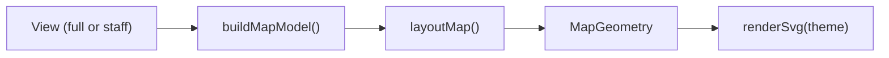

# Design: metro-map-engine

## Context

The [spike](../../../docs/spikes/2026-10-20-map-engine/README.md) built a 400-line prototype (`engine.ts`) that reads a hand-made JSON, routes hops with A* on an octilinear grid, bundles shared hops, places labels and writes SVG. This change rebuilds it on top of the delivered catalogue and views (`src/views.ts`, `src/graph.ts`), with tests. It follows [ADR 3](../../../docs/adr/0003-lines-are-journeys.md), [ADR 4](../../../docs/adr/0004-own-map-engine-with-stored-positions.md), [ADR 7](../../../docs/adr/0007-two-views-built-as-separate-sites.md) and [ADR 9](../../../docs/adr/0009-typescript-end-to-end.md).

## Goals / Non-goals

Goals: a stable, readable map of a real catalogue; a library the website reuses; output safe to embed in a page.

Non-goals: interactivity, raster formats, automatic global layout, writing to the catalogue.

## Decisions

### D1. Two steps: layout, then render

- `src/map/model.ts`: `buildMapModel(view, date)` picks drawn lines (in line order, stops reduced to served components, lines with fewer than two stops dropped), stations, usable positions (first key wins, first in file keeps a shared cell), zones and markers. It reads only the view, so hidden fields cannot reach the map; in `staff` it ignores the date entirely.
- `src/map/layout.ts`: suggestions, routing, parallel offsets, labels, zone hulls, legend. Output is plain data (`MapGeometry`): station points, polylines per line with offsets, label boxes, hull polygons, unrouted hops and suggestions.
- `src/map/svg.ts`: `renderSvg(geometry, theme)` writes the SVG text.

Tests assert on geometry (angles, collisions, positions) and a smaller set checks the SVG itself (safety, determinism, themes). The website will use the geometry to add interactivity.

### D2. Map units

Grid point `[c, r]` is `(64c, 64r)` in map units; padding, header and legend live in the `viewBox`, which is computed from the extent of the drawing. Numbers are rounded to two decimals when written, so output is stable across platforms.

### D3. Routing

A* per hop over grid points inside the bounding box of the hop's two ends widened by three cells, eight directions, with a binary heap and a budget of 50,000 expanded states (then straight fallback). The route is a centreline on grid points; offsets (D4) move strokes off-grid. Cost = length + turn penalty (0 for straight, small for 45°, larger for 90°; sharper turns forbidden) + a crossing penalty for running diagonally across another route, and a small discount for reusing an edge already used by other hops, which pulls lines into tidy corridors as the spike did. Points holding stations other than the hop's ends are blocked. Hops are routed in line order, each hop key once (D4). The spike's preference for keeping a line straight through a station is kept.

### D4. Parallel lines per grid edge

After routing, every grid edge records the lines using it, whichever hop they come from. Each line gets an offset on that edge: lines in line order, left to right when walking the edge from its end whose coordinates sort first, so two lines never coincide and the order does not flip with direction. Where a line's offset changes between consecutive edges, a short horizontal, vertical or 45-degree connector joins the two offset segments. Bundle-crossing minimisation is not attempted; the fixed order is predictable.

### D5. Labels

Eight candidates (right, left, above, below, then diagonals), box sizes from a fixed per-character width table so layout does not depend on installed fonts. Obstacles: other labels, station markers, terminal badges, zone titles, and every line segment as a rectangle as wide as its stroke. Stations are labelled interchanges first (more lines first), then by reference, as the spike did. First candidate with zero overlap wins, else least intersected area, ties to the earlier candidate. Text: two rows of 18 code points, wrapped at spaces, cuts end with `…`; the full text goes in the station's `title`.

### D6. Suggested positions

As in the spec. Placed and already-suggested neighbours both count, each once; octile distance; ties by row then column; free cells exclude every stored key, drawn or not. The suggestion lives only in the output; stackledger never writes it back.

### D7. Markers and the date

Solid marker for `active` or `to-confirm` licences, hollow for `to-buy`; one fixed glyph. The renewal ring is computed only in `full`, inclusive window of 30 days. A test draws two catalogues that differ in every default-hidden field with different dates in `staff` and asserts identical bytes, and asserts the `full` outputs differ so the test is known to exercise the path.

### D8. SVG safety

Element names, attribute names and paint values come from fixed allow-lists written in the spec (the test keeps its own copy, not the renderer's). One `escapeXml` for all catalogue text (`& < > " '`, characters outside XML 1.0 replaced by U+FFFD). Element and attribute names come from fixed allow-lists; no `href`, `style`, `id` or `on*` attribute. Catalogue text appears only in text nodes and in `data-ref` (built from validated names). Colours are written only after matching `#RRGGBB`. Tests parse the SVG with a real XML parser added as a **development** dependency (no runtime dependency) and walk every element and attribute against the allow-lists, on a hostile fixture.

### D9. Command

`stackledger map` reuses the folder checks and views of `mcp`. SVG to stdout, everything else to stderr, exit 0 even when the catalogue has errors: the map is a view, `validate` is the gate. stderr lines are for the person running the command and may name catalogue items.

## Risks / Trade-offs

- **Label quality at crowded interchanges.** When every candidate overlaps, least overlap wins; the owner can move stations.
- **Bundle order crossings.** A fixed order can make parallel lines cross at interchanges; accepted for predictability.
- **Route changes.** Routes are recomputed on every draw and may change when lines change; only station positions are promised to be stable.
- **Text width estimate.** Without measuring fonts, boxes are approximate; a generous width table keeps overlaps rare.
